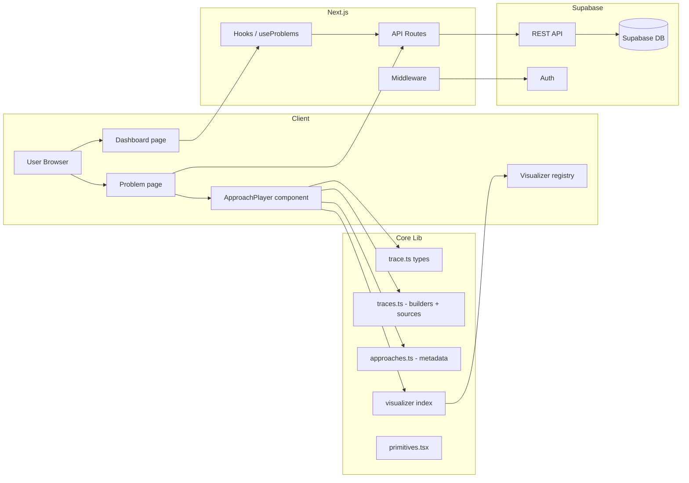
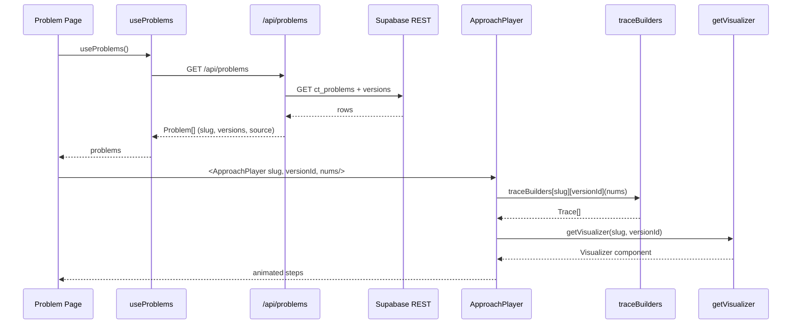
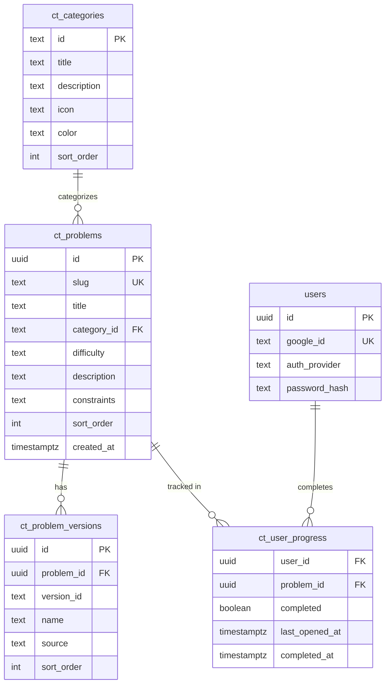

# CodeTrace

> **Watch algorithms run line by line.**

CodeTrace is a production-grade interactive DSA visualizer. It steps through real LeetCode-style problems at **line-level granularity**, highlighting the active source line and animating the underlying data structure (arrays, pointers, hash maps, sets, grids) as the algorithm executes.

Each problem ships **two distinct approaches** — a baseline brute-force and an optimal solution — each with its own bespoke visualizer and trace. The platform is fully authenticated (Google OAuth + email/password) and backed by Supabase.

---

## Table of Contents

- [Features](#features)
- [Tech Stack](#tech-stack)
- [Getting Started](#getting-started)
- [User Flow](#user-flow)
- [Architecture](#architecture)
- [Database Schema](#database-schema)
- [Project Structure](#project-structure)
- [Environment Variables](#environment-variables)
- [Scripts](#scripts)
- [Contributing](#contributing)
- [License](#license)

---

## Features

| Feature | Description |
|---|---|
| **Line-by-line tracing** | Every algorithm is decomposed into granular `TraceStep`s with the active source line highlighted in the code pane. |
| **Per-approach visualizers** | Each of the two approaches per problem has a purpose-built visualizer — pointer scans, bar charts, hash maps, sets, grids. |
| **Live variable readout** | Tracked variables (`i`, `j`, `count`, `max`, ...) are shown as chips alongside each step with `ok`/`fail`/`info` tone coding. |
| **Human explanations** | Every step carries a plain-English explanation of what just happened. |
| **Categorized library** | 13 categories — Arrays, Strings, Bit Manipulation, Hash Table, Two Pointers, Prefix Sum, Sliding Window (Fixed & Dynamic), Kadane's, Matrix, Linked List, In-place Reversal, Fast & Slow Pointers — with per-problem default inputs. |
| **Auth** | Google OAuth (with CSRF state protection) and email/password with session cookies. |
| **Supabase-backed** | Problems, approach source code, and categories are seeded in Supabase and served via a typed REST client. |
| **Progress tracking** | Per-user completion and last-opened timestamps stored in `ct_user_progress`. |

**Coverage:** 119 problems across 13 categories, each with 2 approaches.

---

## Tech Stack

- **Next.js 16** (App Router) — server-rendered pages + client visualizer components
- **React 19**
- **Tailwind CSS v4** — CSS-first configuration via `@theme`
- **TypeScript**
- **Supabase** — authentication and REST data layer
- **Lucide Icons**

---

## Getting Started

### Prerequisites

- Node.js 18+
- A Supabase project
- (Optional) Google OAuth credentials for "Continue with Google"

### 1. Install

```bash
git clone https://github.com/<your-user>/CodeTrace.git
cd CodeTrace
npm install
```

### 2. Configure environment

Copy `.env.example` to `.env.local` and fill in your values:

```env
NEXT_PUBLIC_SUPABASE_URL=your-supabase-project-url
SUPABASE_SERVICE_ROLE_KEY=your-service-role-key
SESSION_SECRET=a-long-random-string
GOOGLE_CLIENT_ID=your-google-client-id
GOOGLE_CLIENT_SECRET=your-google-client-secret
```

> ⚠️ **`.env.local` is git-ignored.** Never commit real credentials. Only the empty `.env.example` template is version-controlled.

### 3. Set up the database

Apply the schema in `db/schema.sql` to your Supabase project (SQL editor), then seed the category and problem rows. The schema creates the tables, row-level-security policies, and the shared `users` auth columns.

### 4. Run

```bash
npm run dev
```

Open [http://localhost:3000](http://localhost:3000).

---

## User Flow

```mermaid
flowchart TD
    A[Visit /] --> B{Authenticated?}
    B -- No --> C[/login]
    C --> D{Sign in method}
    D -- Email/Password --> E[POST /api/auth/signin]
    D -- Google --> F[GET /api/auth/google]
    F -- redirect + state --> G[Google OAuth]
    G -- code --> H[GET /api/auth/callback/google]
    E & H --> I[Set session cookie]
    B -- Yes --> J[Dashboard /]
    I --> J
    J --> K[Browse category]
    K --> L[Select problem /problem/:slug]
    L --> M[Choose approach]
    M --> N[Run trace line by line]
    N --> O[Play / step / speed controls]
    O --> P[Tracked variable readout]
    P --> Q[Result badge + explanation]
    Q --> R[Mark complete / progress]
```

### Step-by-step

1. **Auth** — The user signs in with email/password or Google. Google OAuth sets an `httpOnly` state cookie for CSRF protection, and the callback verifies the echoed state before issuing a session.
2. **Dashboard** — Authenticated users land on `/`, which groups problems by category with per-problem difficulty badges and approach counts.
3. **Problem page** — `/problem/[slug]` loads the problem metadata, its default input, and both approach cards.
4. **ApproachPlayer** — Each approach is a self-contained card: an explanation, the source code with the active line highlighted, and a visualizer driven by a precomputed `Trace`.
5. **Playback** — The user plays, pauses, steps forward/back, resets, or changes speed (0.5×/1×/2×). Every step updates the visualizer, variable chips, result badge, and explanation.
6. **Progress** — Completion state is persisted to `ct_user_progress`.

---

## Architecture



### Data flow for a problem page



### Key design decisions

- **Traces are precomputed, not computed live.** Each `traceBuilder` simulates the algorithm and returns an ordered `TraceStep[]`. The player simply walks the list — this guarantees the animation matches the code and never diverges during playback.
- **Per-approach visualizers.** A visualizer registry (`VISUALIZERS`) maps `(slug, versionId)` to a React component, so every approach can present the algorithm in the most intuitive way rather than forcing one generic renderer.
- **Two approaches per problem.** Every problem implements a brute-force/naive approach and an optimal one, mirroring how interview candidates are expected to iterate.
- **Server-side Supabase access.** A typed `supabaseAdminRequest` wrapper talks to the PostgREST API using the service-role key, so the DB layer is isolated and reusable.

---

## Database Schema

CodeTrace shares a single Supabase database with **Interview Handbook** and **Code Battle**. To avoid table-name collisions, each project prefixes its tables: CodeTrace uses `ct_`, Interview Handbook `ih_`, and Code Battle `cb_`. The `users` table is shared and unprefixed.



### Table reference

| Table | Purpose | Key columns |
|---|---|---|
| `ct_categories` | Category metadata shown on the dashboard (Arrays, Strings, ...) | `id`, `title`, `icon`, `color`, `sort_order` |
| `ct_problems` | One row per problem | `slug` (unique), `category_id`, `difficulty`, `description`, `constraints`, `sort_order` |
| `ct_problem_versions` | Each approach's source code for a problem | `problem_id`, `version_id`, `name`, `source` |
| `ct_user_progress` | Per-user completion state | `user_id`, `problem_id`, `completed`, `completed_at` |
| `users` | Shared auth table (sibling apps) | `google_id`, `auth_provider`, `password_hash` |

### Row-Level Security

- `ct_categories`, `ct_problems`, `ct_problem_versions` — readable by all (`anon`).
- `ct_user_progress` — readable, insertable, and updatable by all (writes happen server-side via the service role).

---

## Project Structure

```
CodeTrace/
├── db/
│   ├── schema.sql          # tables, indexes, RLS, auth columns
│   └── seed.sql            # categories + problem seeds
├── src/
│   ├── app/
│   │   ├── api/
│   │   │   └── auth/       # signin, signup, google, callback, me, set-password
│   │   │   └── problems/   # problem list endpoint
│   │   ├── problem/[slug]/ # problem page (both approaches)
│   │   ├── login/ signup/  # auth pages
│   │   └── page.tsx        # dashboard
│   ├── components/
│   │   ├── ApproachPlayer.tsx        # self-contained trace player
│   │   ├── visualizers/              # one component per approach
│   │   │   ├── index.ts              # VISUALIZERS registry
│   │   │   ├── primitives.tsx        # Frame, Arrow, VarChip, ResultBadge
│   │   │   └── *.tsx                 # per-problem visualizers
│   ├── hooks/
│   │   └── useProblems.ts            # client data hook
│   ├── lib/
│   │   ├── trace.ts                  # TraceStep / Trace types
│   │   ├── traces.ts                 # all trace builders + source maps
│   │   ├── approaches.ts             # per-problem approach metadata
│   │   ├── supabase-rest.ts          # typed Supabase REST client
│   │   └── auth/                     # Google OAuth helpers
│   └── middleware.ts                 # auth guard
```

---

## Environment Variables

| Variable | Description | Required |
|---|---|---|
| `NEXT_PUBLIC_SUPABASE_URL` | Your Supabase project URL | ✅ |
| `SUPABASE_SERVICE_ROLE_KEY` | Service-role key for server-side REST | ✅ |
| `SESSION_SECRET` | Secret used to sign session cookies | ✅ |
| `GOOGLE_CLIENT_ID` | Google OAuth client ID | for Google login |
| `GOOGLE_CLIENT_SECRET` | Google OAuth client secret | for Google login |

---

## Scripts

| Command | Description |
|---|---|
| `npm run dev` | Start the development server |
| `npm run build` | Create a production build |
| `npm run lint` | Run ESLint over the codebase |

---

## Contributing

1. Fork the repository.
2. Create a feature branch (`git checkout -b feat/my-feature`).
3. Add a new problem: define a `traceBuilder`, create a visualizer, register both, and add the approach metadata + seed.
4. Commit with a clear message and open a pull request.

---

## License

[MIT](./LICENSE)
